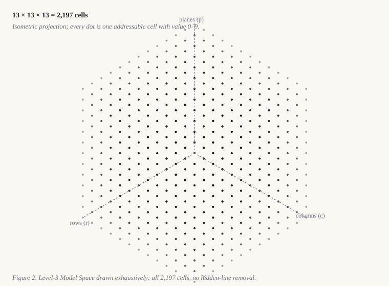
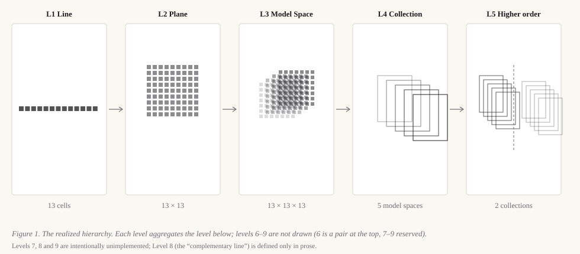
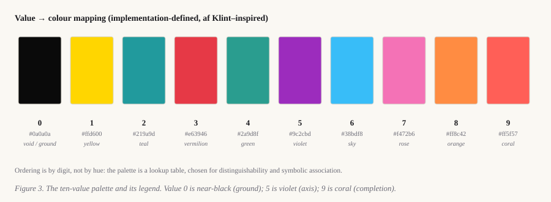
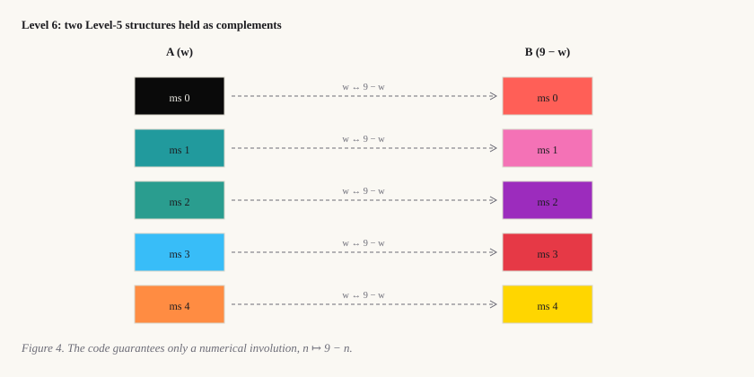

# Friends of Hilma af Klint — Membership System

A membership and payment tool for the **Friends of Hilma af Klint Foundation**.
It lets a person pay for access to the foundation's internal research area. Access
is tied to a verified **DFRI-eID** identity — a client certificate — not to a
cookie or an email address.

This repository contains the membership subsystem as a runnable Next.js 15 app.
The same routes and server modules are embedded in the public
[`friendsofhilma_website`](https://github.com/FriendsofHilma/friendsofhilma_website)
repository; this repo exists so the checkout, ledger, admin tools and tests can
be developed, reviewed and deployed independently.

> **Status: local prototype.** No real money can be taken with the default
> configuration. It is **not production-ready** — see
> [Production readiness](#production-readiness). The ledger is a JSON file and
> there is no session layer yet.



*Figure 2 from the Cosmic Block paper — the default 13³ model space drawn
exhaustively, one point per cell. The figures in this repository decorate the
members' area and are not part of the payment model.*

---

## Try it

These links work when the app and the DFRI-eID verifier are running locally
(see [Running it locally](#6-running-it-locally)). The protected pages must be
opened through the verifier's secure origin.

| Page                  | URL                                  | What it shows                                                          |
| --------------------- | ------------------------------------ | ---------------------------------------------------------------------- |
| Membership & checkout | `http://localhost:8080/membership`   | Approved 200 HOT / 12-month plan, draft tiers, rail availability.      |
| DFRI-eID login        | `http://localhost:8080/internal/login` | Certificate instructions and the link into the mTLS verifier.        |
| Members' library      | `https://localhost:8443/internal/library` | The page that opens after a confirmed membership: status + plates. |
| Admin board           | `https://localhost:8443/internal/members` | Counts, members, payments, grants, revocations and audit trail.    |

The admin board needs `MEMBERSHIP_ADMIN_SUBJECTS=test-person-001` (or another
administrator identity). The test client certificate is
`tools/dfri-verifier/certs/test-person-001.p12`, password `test`.

### What the member flow demonstrates

1. Open `/membership`, choose **Member — 12 months (200 HOT)** and the test rail.
2. Confirm the mock purchase — it goes through the real ledger, expiry and access
   checks, but takes no money.
3. Open `/internal/library`: the server resolves the membership from the verified
   certificate and shows the members' reading room until the expiry date.
4. Administrators can see the new member, the confirmed payment and the audit
   events on `/internal/members`.

---

## 1. What the system does

- Shows the membership plans and their status.
- Requires a verified DFRI-eID certificate before a purchase or the member area.
- Records a payment **intent** with a public reference, verifies the payment
  server-side, and grants time-bounded membership only after verification.
- Supports **HOT** (an ERC-20 token) paid from the member's own browser wallet,
  plus a development mock rail and manual grants by an administrator.
- Gives administrators a page for members, payments, grants, revocations and an
  append-only audit trail.
- Keeps the domain model independent of any payment rail: a rail only decides
  *how* a payment is proven.

### Access rule

```
verified DFRI-eID identity
  AND ( active membership  OR  administrator )
```

`src/middleware.ts` only checks that a verified identity header exists. The
membership check happens in the page and in **every server action**, because
middleware is not a security boundary for server actions.

### Membership is the product; the login is the gate

The DFRI-eID login prototype and the membership tool are separate concerns. The
login proves *who you are*; the membership proves *whether you may enter*. The
internal area currently requires both.

---

## 2. Pricing — what is decided

| Plan                | Code               | Price       | Duration | On sale                            |
| ------------------- | ------------------ | ----------- | -------- | ---------------------------------- |
| Member — 12 months  | `supporter-yearly` | **200 HOT** | 365 days | **Yes** — decided 2026-11-17       |
| Supporter — monthly | `supporter-monthly`| —           | 30 days  | No — price not approved            |
| Patron — lifetime   | `patron-lifetime`  | —           | lifetime | No — price and terms not approved  |

The 12-month plan is `isPlaceholder: false` and active. The monthly and lifetime
tiers are seeded with `active: false`, amount `"0"` and `isPlaceholder: true`, so
they cannot be bought by accident. They appear as “Not on sale yet — price not
approved”.

Plan seeding upserts **by `code`**: changing a price in `src/server/membership/seed.ts`
updates the existing plan record (and therefore the checkout) while preserving
its `id`, which memberships reference. Seeding is enabled by default outside
production and disabled in production (`MEMBERSHIP_SEED_PLANS`), so the live site
does not publish a price just because it exists in code.

**Nothing else about money is decided.** Refunds, grace periods, tax treatment,
receipts, approval thresholds and retention are open policy questions listed in
[§9](#9-decisions-deliberately-not-made) and in `docs/membership.md`.

---

## 3. Payment rails

| Rail       | State                      | What it means                                                                                                  |
| ---------- | -------------------------- | -------------------------------------------------------------------------------------------------------------- |
| `hot-evm`  | **Implemented**            | ERC-20 `Transfer` from the member's wallet to the treasury, verified against an EVM JSON-RPC endpoint.          |
| `mock`     | **Implemented (dev only)** | Records a real membership without money. Refused in production or when dev tools are disabled.                  |
| `manual`   | **Implemented (admin)**    | An administrator records an offline payment and grants access. Always audited.                                  |
| `holofuel` | **Not available**          | Listed with an explanation; it cannot be paid from a web checkout yet.                                          |

### Why HOT

HOT is an ERC-20 token on Ethereum-compatible chains. Unyt bridges HOT through
MetaMask, so paying HOT from a browser wallet is a normal on-chain transfer — a
website can verify it without holding keys or taking custody.

### Why not HoloFuel

Unyt is peer-to-peer accounting on Holochain. A HoloFuel payment needs a running
Holochain conductor, a Unyt agent with its own key pair, and a smart agreement.
There is no hosted checkout or HTTP payment API a Next.js site can call to “take
a HoloFuel payment”. So HoloFuel is **not faked**: the rail is reported as
unavailable with a reason, and manual grants cover the gap in the meantime. A
future `unytConductor` adapter can implement the same `Payment` /
`VerificationOutcome` contract.

---

## 4. How a HOT payment works

```
member                     server                          chain
  │  choose plan + rail       │                               │
  ├─────────────────────────► │ create Payment(pending)        │
  │                           ├─ eth_blockNumber ────────────► │ startBlock
  │ ◄──── reference, amount, token, treasury ────────────────┤
  │  wallet: ERC-20 transfer  │                               │
  ├──────────────────────────────────────────────────────────►│
  │  submit {reference, txHash, wallet}                       │
  ├─────────────────────────► │ markSubmitted                  │
  │                           ├─ eth_chainId / eth_getLogs ──► │
  │                           ├─ eth_getTransactionReceipt ──► │
  │                           ├─ match: from, to, token,      │
  │                           │   exact amount, ≥ N blocks    │
  │                           ├─ confirm → create Membership   │
  │ ◄──── confirmed ──────────┤                               │
```

Verification rules (`payments/hot-evm.ts`):

1. RPC chain id equals the configured chain id.
2. A `Transfer` log for the configured token contract.
3. `from` equals the wallet recorded on the intent.
4. `to` equals the treasury address.
5. Amount equals the intent amount **exactly** — no partial credit.
6. Log block ≥ the block recorded when the intent was created.
7. Transaction status `0x1` and at least `HOT_EVM_MIN_CONFIRMATIONS` blocks.
8. The same transaction hash can never pay two intents.

**Matching limitation:** ERC-20 transfers have no memo field, so an intent is
identified by `(payer, treasury, token, exact amount, block window)`. The
duplicate-transaction guard prevents double credit and the earliest matching
transfer is used, but two identical purchases by the same wallet could in
principle be ambiguous. Reference-bearing transfers (a payment contract or
`transferAndCall`) are the recommended upgrade before real money.

---

## 5. Architecture

```
src/
├── app/
│   ├── page.tsx                     dev landing page (this standalone repo only)
│   ├── membership/                  public plans + checkout UI + server actions
│   ├── internal/                    protected member area, login help, admin page
│   │   ├── login/                   certificate sign-in instructions
│   │   ├── library/                 members-only reading room (Cosmic Block plates)
│   │   └── members/                 admin board: counts, members, payments, audit
│   └── api/membership/dev/          selftest, mock purchase, EVM selftest
├── lib/dfri-eid.ts                  reads verified identity from trusted headers
├── middleware.ts                    protects /internal/:path*
├── public/figures/                  Cosmic Block plates (SVG)
└── server/membership/
    ├── types.ts                     domain types (rail-agnostic)
    ├── money.ts                     integer minor-unit helpers
    ├── store.ts                     MembershipStore + JSON/Memory implementations
    ├── service.ts                   grants, expiry, revocation, duplicate guards
    ├── config.ts                    env-only configuration, no pricing
    ├── seed.ts                      approved price + draft tiers (upsert by code)
    ├── identity.ts / access.ts      identity + membership → access decision
    ├── display.ts                   date formatting
    └── payments/
        ├── index.ts                 rail registry + verification dispatch
        ├── evm-rpc.ts               dependency-free JSON-RPC client
        └── hot-evm.ts               ERC-20 Transfer matcher
```

The domain (`types`, `service`, `store`) knows nothing about Next.js, wallets or
EVM. Routes and payment rails sit on top. This is deliberate: a second rail,
a database, or a different front end can be added without rewriting the rules.

### Data model

- **Plan** — name, decimal amount, currency, interval (`month` / `year` /
  `lifetime`), access length in days (`null` = lifetime), active flag,
  `isPlaceholder` flag.
- **Member** — one per DFRI-eID subject; role `member` | `admin`.
- **Payment** — intent with public reference, rail, integer amount in minor
  units, payer wallet, token, chain, transaction hash, confirmations, status
  (`pending` → `submitted` → `confirmed` | `failed` | `expired`).
- **Membership** — access grant produced by a confirmed payment or manual grant:
  start, expiry (`null` = lifetime), status, revocation reason.
- **AuditEvent** — append-only record of every member/payment/membership change.

All amounts are integer strings in the currency's smallest unit. No floating
point is used for money anywhere.

### Storage

`JsonFileStore` (`MEMBERSHIP_DATA_FILE`, default `.data/membership.json`,
gitignored) writes the whole ledger atomically via a temporary file and rename,
with retries. It is **single-process only**. The `MembershipStore` interface is
the seam for a transactional database, which is required before real money.

---

## 6. Running it locally

### Prerequisites

- **Node.js 20+** (Next.js 15 does not support Node 18).
- `openssl` for test certificates (Git Bash or WSL on Windows).
- Optional: WSL/Linux if you prefer the provided certificate script as-is.

### 1. Install and configure

```bash
npm install
cp .env.example .env
```

With no payment variables set, only the development mock rail is available.

### 2. Generate throwaway test certificates

```bash
# Windows: run through WSL; Linux/macOS: bash directly
wsl -d Ubuntu -e bash tools/dfri-verifier/generate-test-certs.sh
```

This creates a test root CA, issuing CA, server chain and a
`test-person-001` client certificate under `tools/dfri-verifier/certs/`
(gitignored). Never install these on a real machine.

### 3. Start the app and verifier

```bash
# terminal 1
MEMBERSHIP_ADMIN_SUBJECTS=test-person-001 npm run dev

# terminal 2
npm run verifier
```

- `http://localhost:8080/membership` — public plan page
- `https://localhost:8443/membership` — signed-in checkout
- `https://localhost:8443/internal` — member area
- `https://localhost:8443/internal/members` — admin

The verifier strips client-supplied `X-DFRI-EID-*` headers and sets them from the
verified certificate (subject = certificate common name).

**Browser note (Windows):** import `test-person-001.p12` (password `test`) into
*Personal* and, on the test machine only, `root-ca.crt.pem` into *Trusted Root
Certification Authorities* so the browser offers the certificate.

### 4. Verify the stack

```bash
npm run smoke
```

Expected: domain self-test 19/19, end-to-end 9/9. The smoke test exercises the
real ledger and access checks through the mock rail; it does not prove a live
chain payment.

### 5. Optional: verify the ERC-20 matcher

```bash
# terminal 3
npm run mock-rpc

# restart the dev server with:
# MOCK_EVM_RPC_URL=http://127.0.0.1:8599
```

Then open `https://localhost:8443/api/membership/dev/evm-selftest`. Expected:
4/4 (exact payment, wrong amount, wrong chain, no wallet).

### Development endpoints

All require a verified identity and `MEMBERSHIP_ENABLE_DEV_TOOLS`:

| Endpoint                                  | Purpose                                                          |
| ----------------------------------------- | ---------------------------------------------------------------- |
| `GET /api/membership/dev/selftest`        | Domain rules against an isolated in-memory ledger (19 checks).   |
| `GET /api/membership/dev/evm-selftest`    | ERC-20 matcher against `MOCK_EVM_RPC_URL` (4 checks).            |
| `POST /api/membership/dev/mock-purchase`  | `{"planId":"..."}` — completes a mock purchase for the identity. |

They return 404 when dev tools are disabled, which is the production default.

---

## 7. Configuration

Every variable is optional. See `.env.example` and `docs/membership.md`.

| Variable                                          | Purpose                                                                            |
| ------------------------------------------------- | ---------------------------------------------------------------------------------- |
| `MEMBERSHIP_ADMIN_SUBJECTS`                       | Comma-separated DFRI-eID subjects with admin rights. Empty = nobody.               |
| `MEMBERSHIP_DATA_FILE`                            | Ledger path (default `.data/membership.json`).                                     |
| `MEMBERSHIP_SEED_PLANS`                           | Seed/update plans (default: true outside production).                              |
| `MEMBERSHIP_ENABLE_DEV_TOOLS`                     | Mock payments + dev endpoints (default: true outside production).                  |
| `MEMBERSHIP_RENEWAL_STACKS`                       | Start a new purchase after the current one ends (default: true, provisional).      |
| `MEMBERSHIP_CURRENCY`                             | Unit symbol used by draft plans (default `HOT`).                                   |
| `DFRI_EID_LOGIN_URL`                              | Link used by the login page (default `https://localhost:8443/internal`).           |
| `HOT_EVM_RPC_URL`                                 | JSON-RPC endpoint.                                                                 |
| `HOT_EVM_CHAIN_ID`                                | Chain id (default `11155111`, Sepolia).                                            |
| `HOT_EVM_TOKEN_ADDRESS`                           | ERC-20 contract to accept.                                                         |
| `HOT_EVM_TOKEN_DECIMALS`                          | Token decimals (default 18).                                                       |
| `HOT_EVM_TREASURY_ADDRESS`                        | Address that receives payments.                                                    |
| `HOT_EVM_MIN_CONFIRMATIONS`                       | Confirmations required (default 3).                                                |
| `HOT_EVM_NETWORK_NAME`, `HOT_EVM_EXPLORER_URL`, `HOT_EVM_CURRENCY_SYMBOL` | Display only.                                       |

To try a real rail, deploy a throwaway ERC-20 on a testnet, set the `HOT_EVM_*`
variables, restart, and add your test subject to `MEMBERSHIP_ADMIN_SUBJECTS`.
The real HOT mainnet contract is **not** a test asset.

---

## 8. Security model

- The client never confirms its own payment. It submits a transaction hash; the
  server verifies chain state.
- Mock payments are impossible in production: dev tools default to off and the
  dev routes return 404.
- Admin actions require an admin identity **on the server** and are audited with
  the acting subject.
- No private keys exist in the application. Members pay from their own wallet.
- Amounts are integers; there is no floating-point money.
- The JSON ledger is not encrypted. It contains identity subjects and wallet
  addresses — treat it as personal data.

**Prototype caveat:** the app trusts `X-DFRI-EID-*` headers. That is only safe
when the app is reachable *exclusively* through the controlled mTLS verifier,
which must strip client-supplied copies. Production needs a server-side session
and strict network/origin controls in addition to this.

---

## 9. Decisions deliberately not made

These are policy, not engineering. The prototype must not answer them by
accident.

1. Remaining prices for the monthly and lifetime tiers, and whether any tier is
   priced in EUR/USD or HoloFuel rather than HOT.
2. Intervals: is monthly needed? Does lifetime exist at all?
3. Refunds and cancellation: pro-rata, none, or discretionary?
4. Grace periods after expiry, and whether content stays readable.
5. Renewal stacking (currently provisional: a new purchase starts when the
   current one ends).
6. Approval rules: may one admin grant or revoke? Is a second approval required
   above a threshold?
7. Manual grants: which offline payment methods are acceptable?
8. Tax treatment of membership income and token receipts; what receipt or
   invoice a member gets.
9. HoloFuel strategy: require Unyt agents, or accept HOT only?
10. Data retention and privacy: how long subjects, wallet addresses and payment
    records are kept, and who can see them.
11. Who is an administrator, and how that survives staff changes.
12. Whether the internal area is a paid product at all.

The full list with context is in `docs/membership.md` §8.

---

## 10. Production readiness

| Area             | Required before real money                                                                 |
| ---------------- | ------------------------------------------------------------------------------------------ |
| Database         | Replace the JSON store with a transactional DB; unique constraints on reference and tx hash.|
| Sessions         | Issue a server-side session after mTLS instead of trusting headers per request.             |
| Authorization    | Re-check membership/admin on every action and route (done) and add rate limiting.           |
| Payment matching | Reference-bearing transfers or per-intent deposit addresses; remove amount-only matching.   |
| Reconciliation   | Job that re-verifies `submitted` payments, expires stale intents, alerts on mismatches.     |
| Refunds          | Not implemented. Decide policy before accepting money.                                     |
| Receipts         | Not implemented. Decide what members receive for tax/accounting.                            |
| Audit log        | Append-only storage outside the app database, with a retention policy.                      |
| Key management   | Treasury address and RPC credentials in a managed secret store, not `.env` on a laptop.     |
| Hosting          | mTLS at the edge; the app origin unreachable except through the verifier.                   |
| Legal            | Terms, privacy notice, refund policy, and confirmation that token payments are acceptable.   |

Until these are done, this is a **development and demonstration system only**.

---

## 11. Relationship to the website and the Democratic Commons

This repository is a mirror/extraction of the membership code in
`friendsofhilma_website`:

- Same paths and module boundaries (`src/server/membership/**`,
  `src/app/membership/**`, `src/app/internal/**`).
- Same data file format, so a ledger can be moved between the two.
- The standalone `src/app/page.tsx` is a convenience landing page; the website
  keeps its own root layout, navigation and footer.

The tool is designed to fit the commons principles the foundation works with:

- **Autonomy** — the foundation owns its members, ledger, treasury address and
  identity configuration. Nothing here requires a central membership provider.
- **Interoperability** — identity is a standard X.509 certificate subject;
  payment is a standard ERC-20 transfer; the ledger is plain JSON with stable
  keys and a documented schema.
- **Transparency** — every state change is an audit event, prices live in code,
  and the rail limitations are shown to users rather than hidden.
- **Open source** — MIT licensed.
- **Start simple** — no database, no web3 library, no payment processor, no keys
  in the app. Add complexity only when policy requires it.

---

## 12. The Cosmic Block plates

The members' library is decorated with deterministic SVGs from the Cosmic Block
paper. They are stored in `public/figures/` and served as static assets.



*Figure 1 — the realized hierarchy. Each level aggregates the level below.*



*Figure 3 — the ten-value palette. Ordering is by digit, not hue.*



*Figure 4 — Level 6 as a complement relationship.*

The plates are generated by `tools/make-figures.js` in the Cosmic Block project.
They are visual language for the members' area, separate from the membership
model, the ledger and the payment rails.

---

## 13. Documentation

| Document                        | Contents                                                        |
| ------------------------------- | --------------------------------------------------------------- |
| `docs/membership.md`            | Authoritative spec: flows, rails, config, policy, checklist.    |
| `docs/dfri-eid-prototype.md`    | Certificate login prototype, headers, verifier, caveats.        |
| `tools/dfri-verifier/README.md` | Verifier usage, configuration and limitations.                  |
| `.env.example`                  | Every supported environment variable.                           |

---

## License

MIT — see [`LICENSE`](LICENSE).

Contact: [friendsofhilma@gmail.com](mailto:friendsofhilma@gmail.com)
